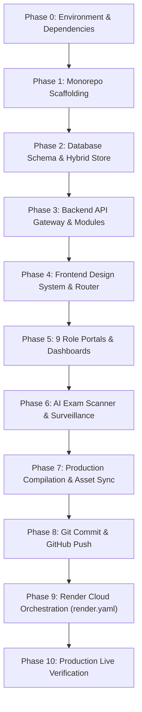

# GBS INTERNATIONAL SCHOOL MANAGEMENT SYSTEM — MASTER AI IDE BUILD COMMAND & BLUEPRINT
## Complete End-to-End Build Specification & Cloud Hosting Protocol for AI IDEs
> **Classification:** CONFIDENTIAL / SYSTEM REFERENCE (HIDDEN)  
> **Target Platforms:** Antigravity, Cursor, Windsurf, Claude Code, GitHub Copilot, Any Agentic AI IDE  
> **Account / Owner Identity:** `gabosei48@gmail.com`  
> **Master Security & Developer PIN:** `0543294615Gab`  
> **Production Cloud Hosting:** Render (`onrender.com`) via `render.yaml`  
> **Git Repository:** `https://github.com/A1-ul/gbs-system.git` (Branch: `main`)  
> **Live Web Services:** `https://gbs-school.onrender.com` & `https://gbs-frontend.onrender.com`

---

## EXECUTIVE DIRECTIVE FOR AI IDEs

When instructed to **"BUILD A GBS SYSTEM"**, the AI IDE must follow this blueprint sequentially from **Step 1 through Step 10** without skipping any architectural layer, security check, database model, or dashboard workspace. Every component must be production-ready, fully responsive, resilient to offline conditions, and wired to the Render cloud deployment pipeline.



---

## PHASE 1: MONOREPO INITIALIZATION & SCAFFOLDING

### 1.1 Root Monorepo Architecture
Create the unified monorepo root structure:
```bash
mkdir GBS_SYSTEM && cd GBS_SYSTEM
git init -b main
git config user.name "Gabriel"
git config user.email "gabosei48@gmail.com"
```

### 1.2 Root `package.json`
```json
{
  "name": "gbs-system",
  "version": "1.0.0",
  "description": "GBS Enterprise Ecosystem - Unified Monorepo Orchestration",
  "private": true,
  "workspaces": [
    "backend",
    "frontend"
  ],
  "scripts": {
    "dev": "node scripts/dev.js",
    "dev:backend": "npm run dev --prefix backend",
    "dev:frontend": "npm run dev --prefix frontend",
    "start": "npm run start --prefix backend",
    "build:frontend": "npm run build --prefix frontend",
    "build:backend": "npm run prisma:generate --prefix backend",
    "build": "npm run prisma:generate --prefix backend && npm run build --prefix frontend"
  },
  "keywords": ["gbs", "enterprise", "school-management", "monorepo", "saas"],
  "author": "GBS SYSTEM",
  "license": "ISC"
}
```

### 1.3 Directory Layout Tree
```
GBS_SYSTEM/
├── backend/
│   ├── data/ (Persistent store gbs_persistent_store.json)
│   ├── prisma/ (schema.prisma)
│   ├── public/ (Compiled frontend SPA bundle + images)
│   └── src/
│       ├── core/ (server.js, config, database/prisma.client.js, socket)
│       ├── middleware/ (auth, rbac, tenant, error)
│       └── modules/ (auth, academic, attendance, finance, cctv, dev-control, ...)
├── frontend/
│   ├── src/
│   │   ├── api/ (client, axios.js, apiConfig.js)
│   │   ├── components/ (common, UniversalDetailPage.jsx, modals)
│   │   ├── modules/ (auth, portal, dashboards, developer-platform, ...)
│   │   └── router/ (AppRouter.jsx)
│   └── vite.config.js
├── render.yaml (Render Cloud Blueprint)
└── .gitignore
```

---

## PHASE 2: DATABASE ARCHITECTURE & HYBRID ENGINE

### 2.1 Prisma Schema (`backend/prisma/schema.prisma`)
The system requires an enterprise relational schema supporting:
1. **Multi-Tenancy:** `Tenant` (with `id`, `name`, `code`, `domain`, `status`, `subscriptionTier`).
2. **Identity & RBAC:** `User` (roles: `SUPER_ADMIN`, `ADMIN`, `TEACHER`, `STUDENT`, `PARENT`, `ACCOUNTANT`, `STAFF`, `HR`, `ALUMNI`, `DEVELOPER`).
3. **Academic Core:** `Class`, `Subject`, `ClassEnrollment`, `TimetableEntry`, `AttendanceRecord`.
4. **Examination & Auto-Grading:** `QuestionBank`, `AnswerSheet`, `AutoGradingResult`.
5. **Treasury & Finance:** `FeeStructure`, `StudentInvoice`, `PaymentTransaction`, `SchoolExpense`.
6. **Infrastructure & Security:** `CCTVStream`, `SecurityGateEvent`, `SystemBackup`, `SystemAlert`, `AuditLog`.

### 2.2 Resilient Cloud-Local Hybrid Engine (`backend/src/core/database/prisma.client.js`)
* Must automatically detect if PostgreSQL (`process.env.DATABASE_URL`) is reachable.
* If PostgreSQL is unreachable or delayed, seamlessly intercept queries and serve from local atomic store [`backend/data/gbs_persistent_store.json`].
* Date matching must normalize ISO strings (`YYYY-MM-DD`) and support Prisma range filters (`gte`, `lte`, `gt`, `lt`).
* Guarantee 100% uptime with zero crashes or unhandled rejections.

---

## PHASE 3: BACKEND API GATEWAY & MICROSERVICE DOMAINS

### 3.1 Server Engine (`backend/src/core/server.js`)
* **Framework:** Express 4.22+ with HTTP + WebSocket (`socket.io`).
* **Security Middleware:** Helmet, CORS (allowing Render origins and custom domains), HPP parameter pollution protection, Rate Limiting (max 1000 req/15m).
* **Compression & Cookies:** `compression()`, `cookieParser()`, `express.json({ limit: '50mb' })`.
* **Static SPA Delivery:** Serves `backend/public/` with client-side fallback `app.get('*', ...)` routing to `index.html`.

### 3.2 Master API Routes
* `/api/v1/auth`: Login, Register, Password Reset, PIN Verification.
* `/api/v1/tenants`: Tenant onboarding, subscription status, multi-tenant isolation.
* `/api/v1/academics`: Classes, subjects, curricula, grade levels.
* `/api/v1/attendance`: 
  - `GET /classes/:classId/roster`: Returns enrolled scholars.
  - `POST /single`: Mark individual student roll call with instant timestamp persistence.
  - `POST /batch`: Batch roll call archive wrap.
  - `GET /classes/:classId`: Filter attendance by date.
* `/api/v1/finance`: Invoicing, 3-step payment gateway settlements, alumni endowments, ledger audit.
* `/api/v1/ai-exam`: Mobile OCR exam script scanner, question bank, auto-marking, grade calculation.
* `/api/v1/dev-control`: PIN-protected developer mission control (`0543294615Gab`), system lock/unlock, DR failover simulation, live server metrics.
* `/api/v1/topic-videos`: Video upload, camera recording, student playback platform.

---

## PHASE 4: FRONTEND WORKSPACE & ROUTING

### 4.1 Frontend Environment & Build Tooling
* **Framework:** React 19 + Vite 7 + React Router 6.
* **API Config (`frontend/src/api/client/apiConfig.js`):**
  - In local dev: routes to `http://localhost:5001/api/v1`.
  - On `gbs-frontend.onrender.com`: intelligently routes to `https://gbs-school.onrender.com/api/v1`.
  - On unified server `gbs-school.onrender.com`: uses same-origin `/api/v1`.

### 4.2 Master Application Router (`frontend/src/router/AppRouter.jsx`)
* `/`: Tenant Onboarding First Page with automated walkthrough and sign-up gates.
* `/login`: Universal Main Login Page with real school campus backdrop.
* `/login/:role`: Dedicated login screens for Admin, Teacher, Student, Parent, Accountant, Staff, Developer.
* `/portal/admin/dashboard`: Super Admin / Headmaster command center.
* `/portal/teacher/dashboard`: Teacher Workspace (attendance roll call, grading, lesson notes).
* `/portal/student/dashboard`: Scholar Hub (CBT exams, peer chat with index search, topic videos).
* `/portal/parent/dashboard`: Parent Portal (ward tracking, GPS bus locator, fee invoices).
* `/portal/accountant/dashboard`: Finance Portal (fee collection, alumni pledges, procurement).
* `/developer-control-center/login` & `/dashboard`: Developer Mission Control (PIN: `0543294615Gab`).
* `/details/:category/:id`: Universal Routed Detail Page with persistent sticky `⬅ Back to Previous Page` navigation.

---

## PHASE 5: THE TEACHER ATTENDANCE TAKING PROTOCOL

### 5.1 Individual Student Roll Call (Tick-by-Tick Workflow)
To ensure 100% compliance with teacher roll call requirements:
1. **Roster Loading:** Load class cohort from `/attendance/classes/:classId/roster` with local persistence fallback.
2. **Individual Student Row:**
   - Display Student Full Name, Index/Matric ID, and status badge.
   - Provide a unified 4-button tick bar:
     - `[ ☑ Tick Present ]` (green)
     - `[ ☒ Tick Absent ]` (red)
     - `[ ⏰ Tick Late ]` (amber)
     - `[ 📝 Tick Excused ]` (blue)
     - `[ ⚪ Reset ]` (gray)
3. **Immediate Auto-Save:** Clicking any tick immediately:
   - Updates state optimistically (`attendanceRecords`).
   - Writes to `localStorage` key `gbs_attendance_${classId}_${date}`.
   - Syncs to `gbs_student_attendance_summary` and dispatches `gbs_attendance_updated`.
   - Posts asynchronously to backend `POST /api/v1/attendance/single`.
   - Displays permanent badge `✓ Ticked & Auto-Saved at [HH:MM:SS]`.
4. **Completion Gate:**
   - The teacher moves down the roster, ticking each student one by one.
   - Progress meter tracks: `Ticked: X / N Students`.
   - When the teacher clicks `💾 COMPLETE ROLL CALL & WRAP INTO ARCHIVES`:
     - If any student is unticked, the system warns: *"⚠️ Roll call incomplete: X student(s) pending tick. Please tick every student one by one to complete attendance taking."*
     - When all students are ticked, the day is wrapped into `gbs_daily_attendance_archives` and posted to `/attendance/batch`.
     - The saved archive appears in the archive vault table below with a 1-click `👁️ View Full Roll Sheet` button routing to `/details/attendance/:id`.

---

## PHASE 6: 100% STUDENT-BASED SUBSCRIPTION PRICING

The system enforces the official GBS student population subscription policy:
* **Nursery to JHS:** `GH₵ 3` per active student / month.
* **SHS:** `GH₵ 5` per active student / month.
* **University / Tertiary:** `GH₵ 10` per active student / month.
* **Duration Discounts:**
  - 1 Month: `0%`
  - 3 Months: `3%`
  - 6 Months: `5%`
  - 9 Months: `7%`
  - 12 Months: `10%`
* **Formula:**
  $$\text{Invoice Total} = (\text{Active Students} \times \text{Rate} \times \text{Months}) \times (1 - \text{Discount})$$
* **No Platform Fees:** No fixed tenant fee, no base fee, and no retrospective clawbacks.

---

## PHASE 7: PRODUCTION COMPILATION & ASSET SYNCHRONIZATION

Run the production build commands in PowerShell or Bash:
```powershell
# 1. Compile Vite frontend production bundle
npm run build --prefix frontend

# 2. Synchronize compiled assets to backend public directory
Copy-Item -Path "frontend/dist/*" -Destination "backend/public" -Recurse -Force

# 3. Clean up obsolete chunks to prevent disk clutter
# (Keep only the newly generated index-*.js and index-*.css files)
```

---

## PHASE 8: GIT VERSION CONTROL & GITHUB PUSH

Archive and synchronize all changes directly to the remote repository:
```powershell
# 1. Verify working directory status
git status

# 2. Stage all changes
git add -A

# 3. Commit with author credentials
git commit -m "feat: complete GBS System enterprise architecture and cloud deployment pipeline" --author="Gabriel <gabosei48@gmail.com>"

# 4. Push to remote main branch
git push origin main
```

---

## PHASE 9: CLOUD HOSTING ON RENDER (`render.yaml`)

### 9.1 Render Blueprint Configuration (`render.yaml`)
Place this `render.yaml` in the project root:
```yaml
services:
  # 1. Unified Enterprise Node.js Web Service & API Gateway
  - type: web
    name: gbs-school
    env: node
    rootDir: backend
    buildCommand: npm install && npm run build
    startCommand: npm start
    plan: free
    autoDeploy: true
    envVars:
      - key: NODE_ENV
        value: production
      - key: PORT
        value: 5001
      - key: HOST
        value: 0.0.0.0
      - key: CORS_ORIGIN
        value: https://gbs-school.onrender.com,https://gbs-frontend.onrender.com,https://gbs-schools.com,https://www.gbs-schools.com
      - fromDatabase:
          name: gbs-db
          property: connectionString
        key: DATABASE_URL

  # 2. Static CDN Frontend Service
  - type: web
    name: gbs-frontend
    env: static
    rootDir: frontend
    buildCommand: npm install && npm run build
    staticPublishPath: ./dist
    plan: free
    autoDeploy: true
    routes:
      - type: rewrite
        source: /*
        destination: /index.html
    headers:
      - path: /*
        name: Cache-Control
        value: no-cache

databases:
  # 3. Production PostgreSQL Database
  - name: gbs-db
    databaseName: gbs_production
    user: gbs_admin
    plan: free
```

### 9.2 Render Cloud Connecting Steps
1. Log in to [Render Dashboard](https://dashboard.render.com) using GitHub account (`gabosei48@gmail.com`).
2. Click **New +** -> **Blueprint**.
3. Connect the repository: `https://github.com/A1-ul/gbs-system.git`.
4. Render detects `render.yaml` and provisions:
   - `gbs-school` (Web Service on Node.js 20+)
   - `gbs-frontend` (Static Site on CDN)
   - `gbs-db` (PostgreSQL Database)
5. Auto-deploy triggers automatically upon every push to `origin/main`.

---

## PHASE 10: MASTER COPY-PASTE AI IDE INVOCATION PROMPT

To instruct any AI IDE to build a new GBS System from scratch, provide this exact prompt:

```text
You are Antigravity / Master AI Software Engineer.
Your task is to build a complete, production-ready GBS International School Management System from scratch, matching the official Enterprise Blueprint:

1. ARCHITECTURE & MULTI-TENANCY:
   - Scaffold a monorepo with /backend (Express, Prisma, PostgreSQL with resilient local JSON fallback, Socket.IO) and /frontend (React 19, Vite 7, React Router 6).
   - Configure multi-tenancy with strict tenant data isolation, RBAC middleware, and JWT authentication.

2. DASHBOARDS & ROLES:
   - Tenant Onboarding First Page at "/" with school registration and payment intake.
   - Dedicated login screens for Admin, Teacher, Student, Parent, Accountant, Staff, and Developer.
   - Admin Executive Portal: Vetting desk, 6-channel CCTV camera matrix, staff OTP, and walk-in admissions desk.
   - Teacher Interactive Workspace: Enforce tick-by-tick individual student roll call (Present, Absent, Late, Excused) with instant auto-save per student and batch archive wrap.
   - Student Scholar Hub: CBT exam studio, peer scholar chat with index search & verification modal, live video call, and 14-day digital syllabus library loans.
   - Accountant & Finance Portal: Fees ledger, 3-step payment gateway (MoMo USSD countdown, 3DS cards, bank wire), and philanthropic alumni endowment ledger.
   - Parent Portal: Ward academic reports, emergency school bus GPS tracker, and fee invoices.
   - Developer Mission Control (PIN: 0543294615Gab): 49 system control panels, tenant management, and intrusion sentinel.
   - Universal Routed Detail Page (/details/:category/:id) with persistent sticky back button.

3. ADVANCED SUBSYSTEMS:
   - Mobile Camera AI Exam Scanner with hardware camera stream, OCR handwriting recognition, teacher answer keys, and split-screen manual review.
   - Official Student-Based Subscription Pricing: Nursery-JHS GH₵3, SHS GH₵5, University GH₵10, with 0%-10% discounts for 1-12 months.

4. COMPILATION & CLOUD DEPLOYMENT:
   - Compile Vite bundle to frontend/dist and sync to backend/public.
   - Commit all changes to Git branch main with author Gabriel <gabosei48@gmail.com> and push to origin/main.
   - Orchestrate deployment to Render (onrender.com) using render.yaml for web service gbs-school, static CDN gbs-frontend, and database gbs-db.
   - Verify health endpoints at /health and /api/v1/health with zero runtime errors.
```

---
*End of Master AI IDE Build Directive — GBS System*

